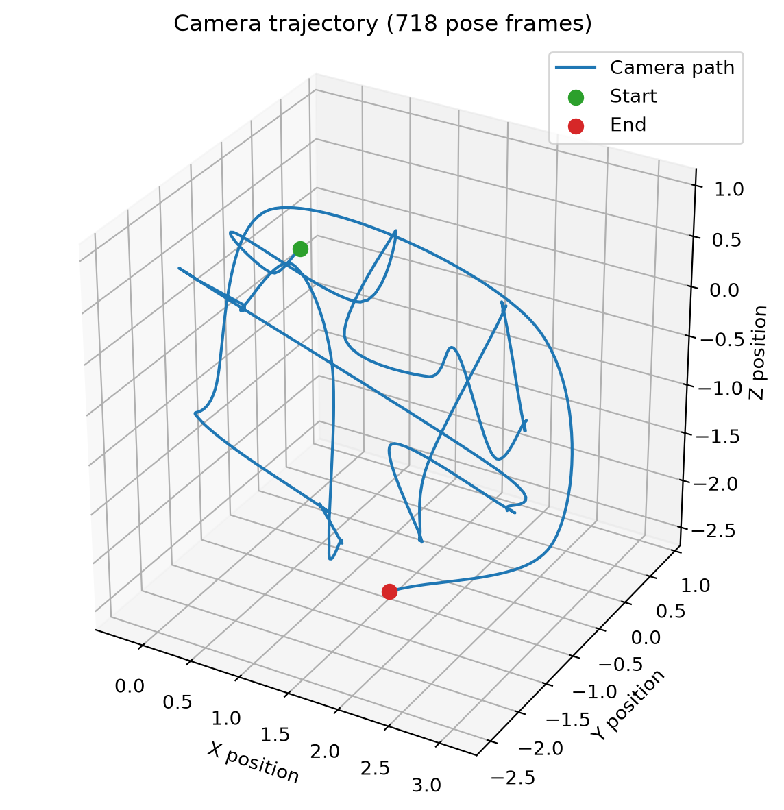
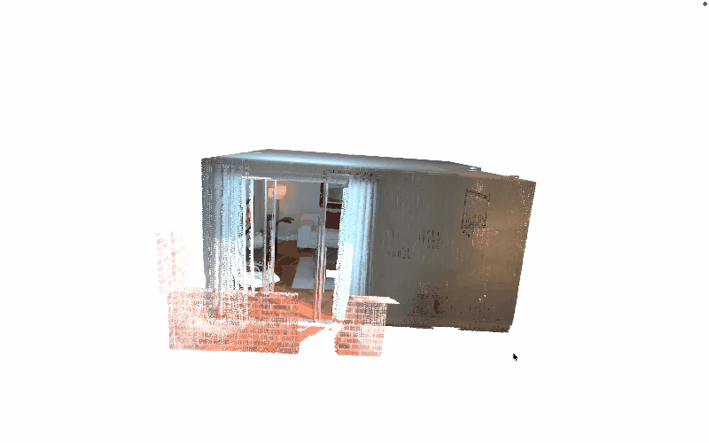

# Short Overview 

---

Module is devided into two parts:
---

These are core geometrical approaches to solve the problem without using external deep model.

***odometry algorithm:***
 It estimated the camera postions accross the frames. Calcuate the geometrical and spatial(contrast) difference from previous frames.


***reconstruction :*** 
crearing point clouds + TSDF

Creating point clouds: tranform RGB info + depth into the 3D points ---> transform these point into 3d world coordinates ---> Fusion(combined accross the frames)

Worked on Open Source data similer to AR Core. AR Core not supported in my device.
https://www.open3d.org/docs/release/python_api/open3d.data.RedwoodIndoorLivingRoom1.html


AR Core data/
- RGB
- Depth Maps
- Poses(Rotation)
- Translation (worlds coordinates)
- Camera Intrinsics
- Time stamps


```json   

Input Smaple

 "intrinsics": {
    "width": 640,
    "height": 480,
    "fx": 525.0,
    "fy": 525.0,
    "cx": 319.5,
    "cy": 239.5
  },
  "frames": [
    {
      "color": "color/00000.png",
      "depth": "depth/00000.png",
      "camera_pose": [
        [
          0.6417163755552173,
          0.5200234776992612,
          -0.563715953283071,
          -0.8683
        ],
        [
          -0.7662444835312714,
          0.40337702302857376,
          -0.5001563443069585,
          0.6026
        ],
        [
          -0.03270297849081383,
          0.7529027559613337,
          0.6573187622939558,
          1.5627
        ],
        [
          0.0,
          0.0,
          0.0,
          1.0
        ]
      ]
    },
```
---


<table>
  <tr>
    <td width="50%">
      
        <p align="center"><b>Camera Trajectory</b></p>
    </td>
    <td width="50%">
      
          <p align="center"><b>3D Mesh at Output(FRAME_STEP = 4)</b></p>
    </td>
  </tr>
</table>


<p align="center">
  
  <br>
  <b>Fused Point Clouds</b>
</p>


---


Created a video file with frame to make the visulization of input:

! [input_video](redwood_dataset_video.mp4)

Here is the Output files- room_mesh(mesh file) and room_fused(cloudpoint file)

! [output(3d_reconstructed_plane)](outputs\room_mesh.ply)
("git lfs pull" after cloning becuase mesh size is 128mb github supports 100mb only)

---
```text
Run Commands

pip install requirements.txt
python main.py
```
